<div align="center">

[🇷🇺 Русский](README.md) &nbsp;•&nbsp; **🇬🇧 English**

# 🟥 R34 Gallery

**A local rule34.xxx gallery browser with its own interface, themes and games.**


</div>

> [!WARNING]
> **18+** This project displays adult content and is not intended for minors.
> It is an **unofficial client**: it is not affiliated with rule34.xxx or its staff. All content
> belongs to its respective owners and you are responsible for how you use it. Make sure viewing
> such content is legal where you live.

The project started out of plain annoyance: existing sites were unpleasant to use, slow, or
poor on phones. So this one ships its own frontend, its own themes and a fully local server —
your keys and data never leave your machine.

<details>
<summary><b>Contents</b></summary>

- [Screenshots](#-screenshots)
- [What's inside](#-whats-inside)
- [Quick start](#-quick-start)
- [CLI options](#️-cli-options)
- [Games](#-games)
- [Interface language](#-interface-language)
- [Themes and styling](#-themes-and-styling)
- [Data and privacy](#-data-and-privacy)
- [Project structure](#-project-structure)
- [Checks](#-checks)
- [Troubleshooting](#-troubleshooting)
- [Updating](#-updating)
- [Contributing](#-contributing)

</details>

---

## 📸 Screenshots

> Feed thumbnails are blurred in these images so no explicit content ends up in the repository.

**Desktop**

| Gallery | Favorites |
|---|---|
| 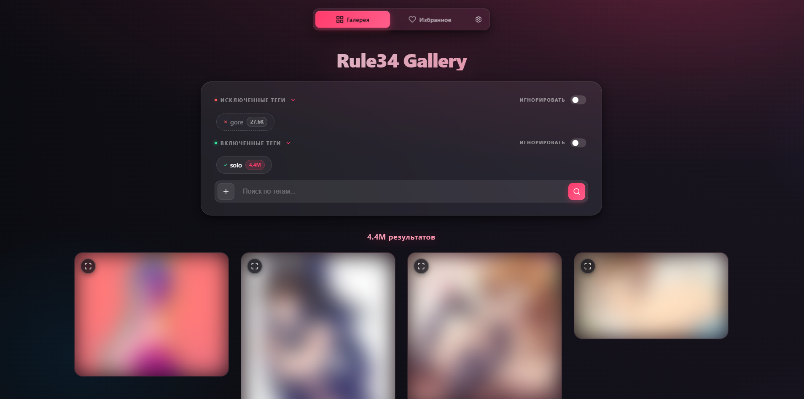 | 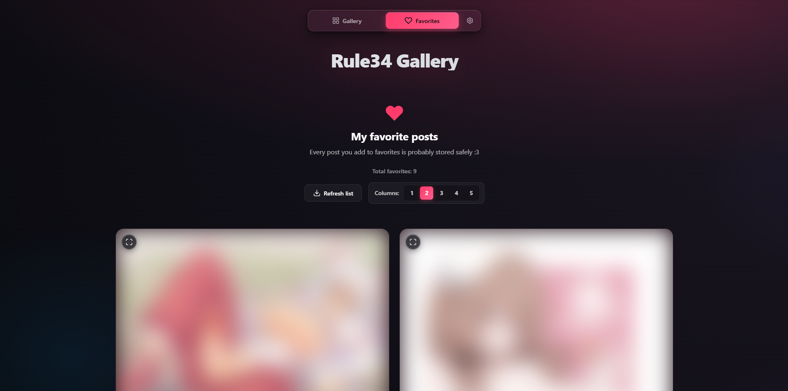 |

| Media info | Settings |
|---|---|
| 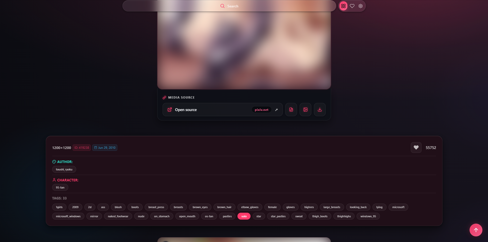 | 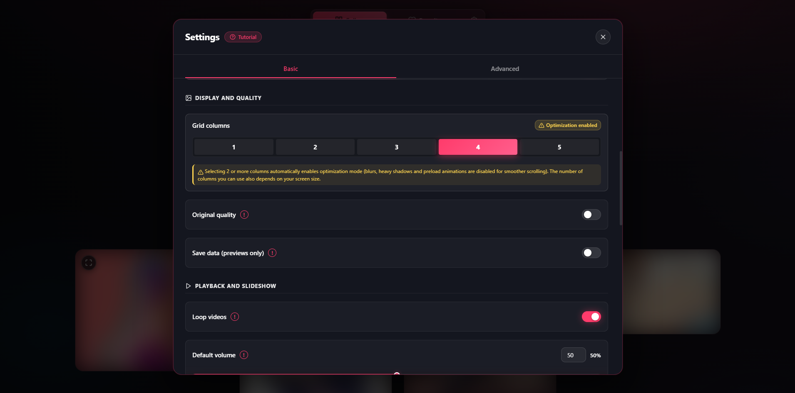 |

| Game selection | Puzzle |
|---|---|
| 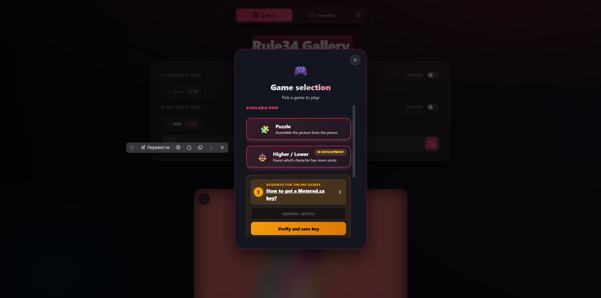 | 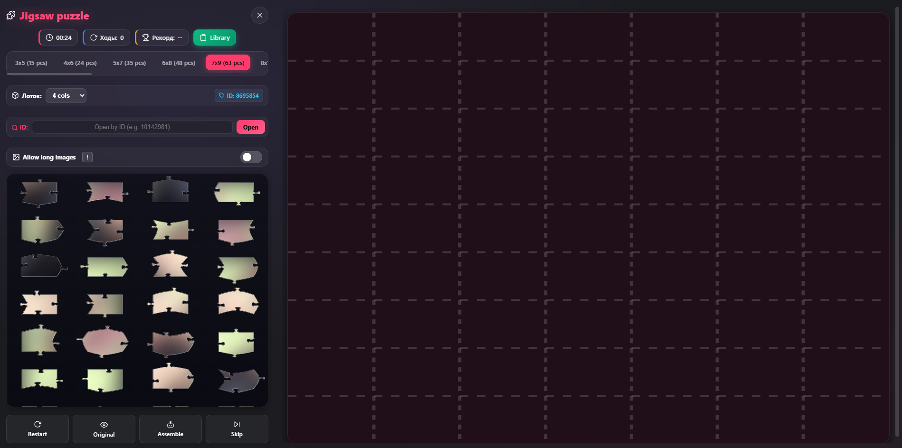 |

**Phone**

| Gallery | Favorites | Settings |
|---|---|---|
| 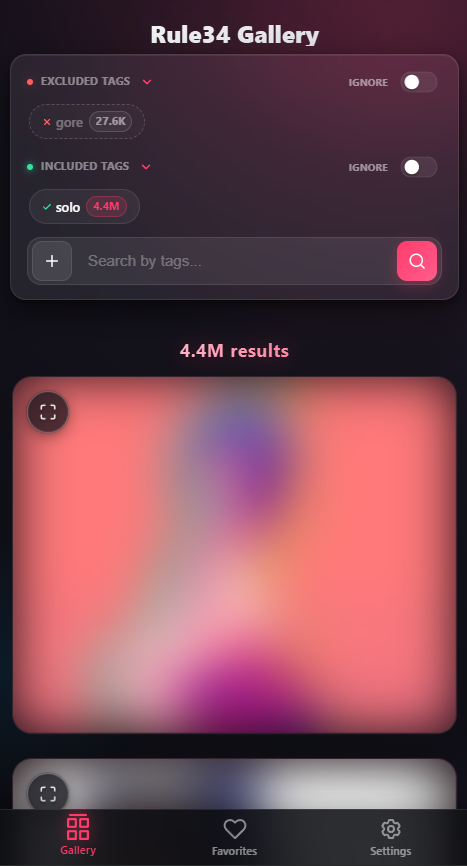 | 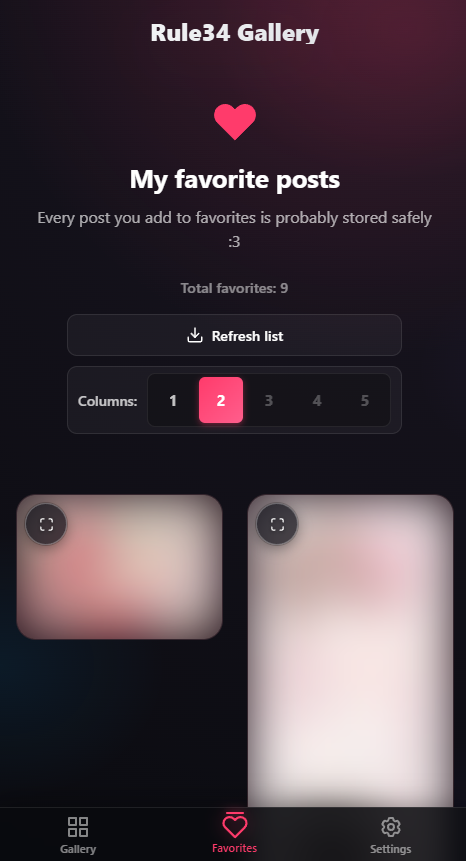 | 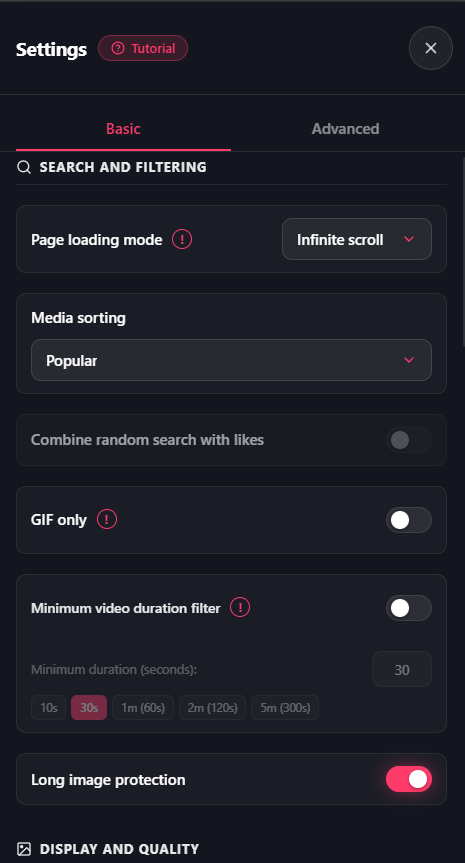 |

| Media info | Game selection | Puzzle |
|---|---|---|
| 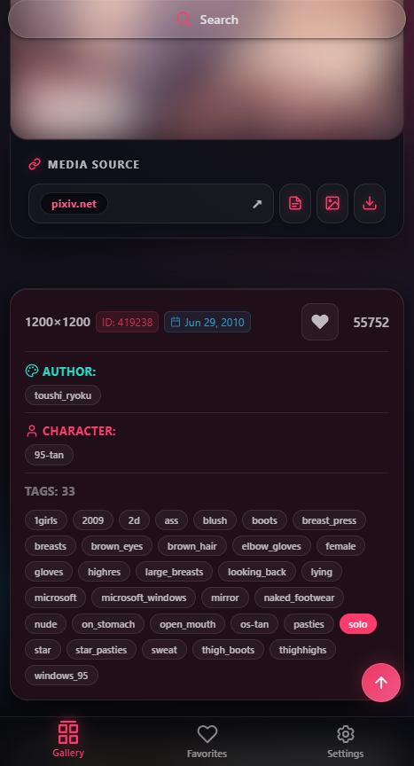 | 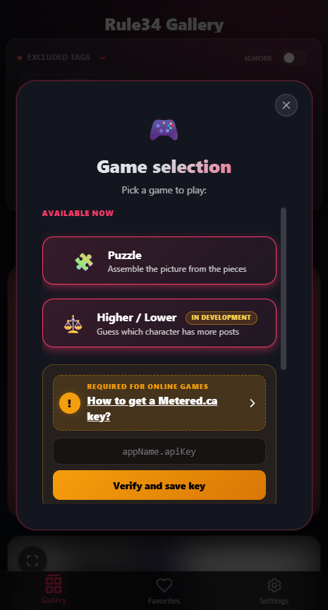 | 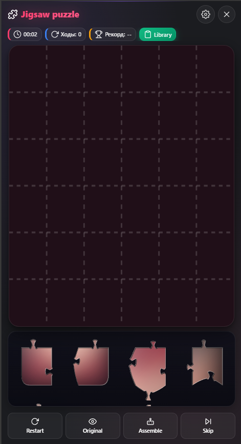 |

---

## ✨ What's inside

| | Section | Features |
|---|---|---|
| 🔎 | **Search** | Tag search with suggestions, excluded tags, score filter, GIF-only, random search, endless feed, autocomplete |
| 🖼 | **Gallery** | Grid with configurable columns, card rounding and borders, hover effects, preloading, fullscreen viewer, video player, 360°/180° VR mode |
| ⭐ | **Favorites** | Saved posts, filtering, a dedicated mode for quick access |
| 🎨 | **Appearance** | Ready-made theme presets, custom accent color, font and scale, header style, custom logo, expert style editor |
| 📖 | **Tutorial** | Built-in cheat sheet in settings: how tags, filters and the key options work |
| 🎮 | **Games** | Puzzle with offline and online modes, "Higher/Lower" (experimental) |
| 📱 | **Mobile** | Bottom navigation, responsive settings, low-end device mode, traffic saving |
| 🔐 | **Privacy** | API keys encrypted on disk, session cookie, "safe screen" hotkey, no telemetry |
| ☁️ | **Sync** | Optional sync of favorites and solved puzzles via Turso (SQLite in the cloud) |

---

## 🚀 Quick start

**Requirements:** Python 3.8+ (on Windows, tick *Add python.exe to PATH*),
optionally `node` — it is only needed for the JS and dictionary checks in `tests/`.

### Android (Termux)

```bash
# 1. Grant Termux access to storage (once)
termux-setup-storage

# 2. Find the project folder and enter it
find /storage/emulated/0 -type d -name "rule34" | head -n 1
cd /storage/emulated/0/PATH/TO/rule34

# 3. Run: installs dependencies and starts the server
sh run_termux.sh
```

> The first run is slow: Termux installs Python, Rust and Clang, then builds the crypto
> packages. After that startup takes seconds.

### Windows

1. Install [Python 3.8+](https://www.python.org/downloads/windows/) and tick
   **Add python.exe to PATH** during setup.
2. Run `run_windows.bat` — it checks Python, installs dependencies and starts the server.

### Linux / macOS

```bash
pip install -r requirements.txt
python server.py
```

### Open in a browser

```
http://127.0.0.1:3000
```

A phone or another PC on the same network can use `http://<lan-ip>:3000` (printed at startup);
that requires `lan` mode, see below.

On first launch you'll be asked for a **user_id** and a **rule34 API key**. Both come from your
[rule34.xxx account settings](https://rule34.xxx/index.php?page=account&s=options)
(sign-in required; to make `api_key` appear, tick **Generate New Key** and hit **Save**) — the login page
walks you through it. Keys are stored encrypted in `R34/.secrets/`. To log out and clear saved
keys, open `/logout`.

> The commands above are a terminal cheat sheet — you run them yourself. The helper scripts
> `run_termux.sh` and `run_windows.bat` are also started by hand, each on its own system.

---

## ⚙️ CLI options

| Flag | Description |
|---|---|
| `--port`, `-p` | Port (default `3000`) |
| `--host`, `-H` | Bind address; overrides the selected mode |
| `--mode`, `-m` | `local` — this computer only (`127.0.0.1`), `lan` — reachable from the local network (`0.0.0.0`) |
| `--lang`, `-l` | Interface language: `ru` or `en`. Saved and reused on the next starts |
| `--https` | HTTPS with a self-signed certificate. Needed for the phone gyroscope and WebXR: browsers expose them only in a secure context |

On the very first start the server asks for the language (`1` — Russian, `2` — English) and then
for the access mode (`1` — this computer only, `2` — the whole local network). The language is
saved, so you will not be asked again.

```bash
python server.py --mode lan --https --port 3000
```

---

## 🎮 Games

**How to open:** tap the site title **5 times** — the game picker appears.

### 🧩 Puzzle

An image from the gallery is split into pieces; there are several difficulty levels, a timer,
shuffling and saved progress. Works offline and with two to four players over the network.

### 🌐 Online

- **Transport** is WebRTC, so across different networks (behind NAT) you may need a TURN relay:
  a Metered key is entered in the online game window, with instructions right there.
- **Signaling** uses the public PeerJS broker (`0.peerjs.com`). If your provider blocks it, a
  room can't be created and the app shows `Lost connection`. A VPN works around it.

### 🎲 Higher/Lower

An experimental game inside the same window. Development has stopped — it is unstable; anyone
who wants to finish it is welcome to.

---

## 🌐 Interface language

The interface switches between Russian and English without a page reload —
**Settings → System and data → Interface language**. The choice is stored in the browser, in
synced settings and on the server, so it follows you to other devices.

The server-side startup language lives in `R34/.secrets/language.json`. Delete that file if you
want the server to ask again, or pass `--lang en`.

English strings live in [R34/static/js/i18n/locales/en.js](R34/static/js/i18n/locales/en.js): the
dictionary is a list of "Russian text → English" pairs. Most of the interface is translated; if
some hint is still Russian, add one line to that file — no markup changes needed.

---

## 🎨 Themes and styling

Settings include ready-made **theme presets** (they change the background and accent colors
together) and a **custom accent color** for fine tuning. Also: interface font and base scale,
header style, custom logo, card rounding and border, glow intensity, animation speed, and an
expert style editor for detailed tweaks.

---

## 🔐 Data and privacy

- The server listens only on your machine or your network — no external services are required
  to browse the gallery.
- Your rule34 API key is stored encrypted in `R34/.secrets/` and never sent to the browser.
- User endpoints under `/api/*` are guarded by a session cookie: another computer on the same
  network can't read your settings and favorites without passing the login page.
- No telemetry, no analytics. Turso is opt-in and works only with your own token.
- Outbound connections happen only where they are unavoidable: requests to rule34.xxx, the
  PeerJS signaling broker and the Metered TURN relay (if you provide a key).

> **Never commit `R34/.secrets/`** — it holds your keys, favorites and settings.

---

## 🗂 Project structure

```
.
├── server.py            # Flask app: network modes, API guard, HTTPS
├── requirements.txt
├── run_termux.sh        # Android (Termux) launcher
├── run_windows.bat      # Windows launcher
├── handlers/            # server logic: auth, proxy, games, rooms, Turso
├── R34/
│   ├── index.html       # gallery interface
│   ├── login.html       # API key login
│   ├── .secrets/        # keys and local data (do not publish)
│   └── static/
│       ├── css/         # themes, gallery, search, responsive rules
│       └── js/          # UI, puzzle, multiplayer, themes, viewers
├── game_data/           # cached game data
└── safe_screen/         # "safe screen" files
├── tests/               # self-checking test suite (see tests/README.md)
│   ├── run_tests.py     # walks the project: python, JS, CSS, HTML, i18n, server
│   └── README.md        # test docs (ru: tests/README.md)
└── LICENSE              # MIT
```

---

## 🧯 Troubleshooting

| Problem | Fix |
|---|---|
| `Lost connection to server` when creating a room | The PeerJS broker is unreachable (provider/Cloudflare block). Use a VPN or retry later |
| Online play fails between different networks | You need a Metered TURN key — enter it in the online game window |
| Port already in use | `python server.py --port 3001` |
| A phone can't reach `192.168.*` | The server is in `local` mode. Start it with `--mode lan` |
| The browser warns about the certificate | It is self-signed and local: "Advanced" → "Proceed". The warning is accepted once |
| Gyroscope and VR don't work on a phone | Use `--https`, or open the site via `localhost` |
| It asks you to log in again | Open `/logout` and enter your `user_id` and API key again |
| Slow on a low-end phone | Enable "Low-end device mode", reduce columns and card preloading |

---

## 🧪 Checks

The project ships a self-checking test suite — a single file `tests/run_tests.py`,
standard library only, no browser. It walks the project (pages, Python, JS, CSS,
JSON, translations), finds entry points on its own and names the file, line and
reason for every failure.

```bash
python tests/run_tests.py             # everything (~6 s)
python tests/run_tests.py --fast      # skip the HTTP run and node --check
python tests/run_tests.py --lang en   # English output
```

The output language defaults to the one chosen in the app (`R34/.secrets/language.json`);
`--lang ru|en` overrides it. Details in [tests/README.md](tests/README.md)
(English: [tests/README.en.md](tests/README.en.md)).

---

## 🔄 Updating

```bash
# in the project folder
git pull
```

- Local data (`R34/.secrets/`, `game_data/`) is not in the repository, so
  `git pull` will not overwrite it.
- If the server no longer starts after an update, delete `R34/.secrets/language.json` —
  the next launch will ask for the language and access mode again.
- To confirm everything is in place, run `python tests/run_tests.py`.

---

## 🤝 Contributing

The project was written entirely by free AI models — hence the occasionally rough code. Found
a bug or want to improve something? Fork it, patch it, open a pull request. Any help is
welcome; that is exactly why this project is public.
